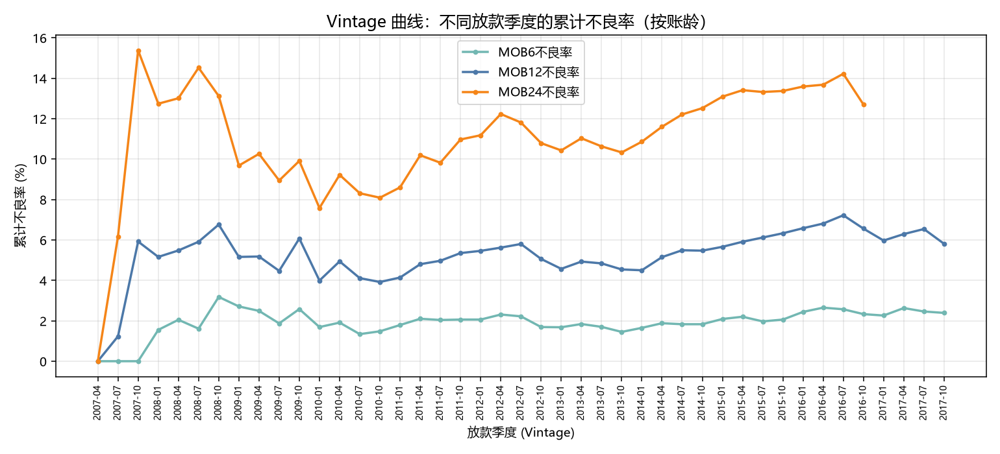
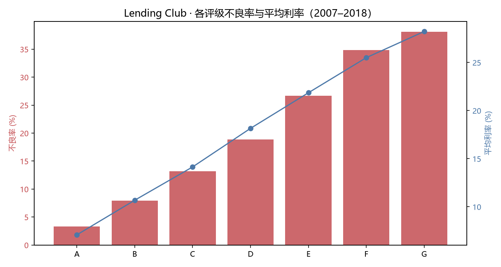
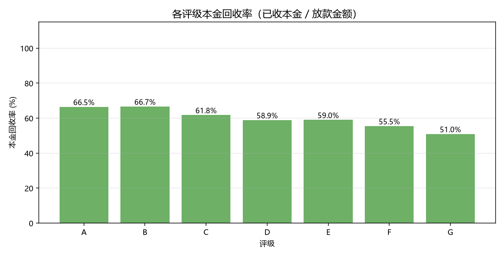

# 银行贷款风险分析

> **一句话结论**：Lending Club 2007–2018 年 226 万笔贷款中，**评级从 A 到 G，不良率从 3.28% 升到 38.08%，相差 11.6 倍**；Vintage 分析显示 2007Q4 放款（金融危机前）24 期累计不良率高达 **15.5%**，而 2013–2015 年放款仅 **10.4–10.9%**，说明风控能力在 2010 年后显著改善，但 2016 年又开始回升到 **14.2%**。



---

## 项目简介

对 226 万笔真实消费信贷数据做风险分析与回款评估，覆盖**风险分层、Vintage 账龄、账龄-状态分布、回款率**四个维度，为风控策略提供数据依据。

**技术栈**：DuckDB（258 MB Parquet 秒级聚合）· Python 3.12 / pandas / matplotlib

## 数据

| 项 | 内容 |
|---|---|
| 来源 | [Lending Club Accepted Loans](https://huggingface.co/datasets/codesignal/lending-club-loan-accepted)（2007-06 ～ 2018-12）|
| 规模 | **2,260,701 笔**，151 字段，1.56 GB CSV → **258 MB Parquet** |
| 有效样本 | **2,257,919 笔**（排除 2,749 条 `Does not meet the credit policy` 特殊样本）|
| 放款总额 | **339.91 亿美元** |
| 关键字段 | `loan_status` / `grade` / `int_rate` / `issue_d` / `last_pymnt_d` / `total_rec_prncp` / `total_pymnt` / `recoveries` / `out_prncp` |

## 核心发现

### 1. 评级与风险高度单调

| 评级 | 笔数 | 平均利率 | 不良率 |
|---|---|---|---|
| A | 432,929 | 7.08% | **3.28%** |
| B | 663,203 | 10.68% | 7.93% |
| C | 649,424 | 14.14% | 13.19% |
| D | 323,733 | 18.15% | 18.86% |
| E | 135,103 | 21.85% | 26.68% |
| F | 41,553 | 25.50% | 34.88% |
| G | 11,974 | 28.22% | **38.08%** |

评级每降一档，不良率几乎翻倍——**评分卡在起作用**，但 A 级 3.28% 对 7.08% 的利率而言仍然偏保守（价差约 3.8pp 覆盖 3.28% 的损失，缓冲空间有限）。



### 2. Vintage 账龄：2008 危机与 2016 回升

按放款季度分组，只看观测期足够长的 cohort（避免 right-censoring 低估）：

| 放款季度 | 笔数 | MOB6 | MOB12 | MOB24 |
|---|---|---|---|---|
| 2007Q4 | — | 6.19% | — | **15.51%** |
| 2013Q1–2015Q4 | — | 1.9–2.5% | 4.4–6.4% | **10.4–10.9%** |
| 2016Q1 | 133,887 | 2.44% | 6.58% | **13.59%** |
| 2016Q4 | 103,546 | 2.33% | 6.56% | 12.70% |

**三个结论**：
- 2007–2008 放款的坏账率是 2013–2015 的 **1.4 倍**，危机冲击清晰可见
- 2010 年后风控显著收紧，MOB12 从 6.7% 降到 4.4%
- **2016 年起又回升到 13.6%**，与当时 Lending Club 放宽准入、扩大次级客群的策略吻合

### 3. 账龄 × 状态分布

| 账龄区间 | 笔数 | 已结清 | 在还中 | 逾期中 | 已核销 |
|---|---|---|---|---|---|
| 00–05 月 | 279,019 | 42.55% | 43.83% | 1.20% | 12.42% |
| 06–11 月 | 459,361 | 34.75% | 48.81% | 1.57% | **14.87%** |
| 12–23 月 | 720,270 | 42.37% | 41.17% | 1.74% | 14.71% |
| 24–35 月 | 453,345 | 51.66% | 35.85% | 1.68% | 10.81% |
| 36+ 月 | 345,924 | 74.87% | 21.02% | 1.03% | 3.08% |

**风险集中在放款后 6–24 个月**，这是催收与预警的黄金窗口。

### 4. 回款分析（本项目增量）

| 评级 | 放款(亿) | 已收本金(亿) | 本金回收率 | 总回款率 |
|---|---|---|---|---|
| A | 63.23 | 42.03 | **66.47%** | 73.99% |
| C | 97.70 | 60.38 | 61.80% | 80.23% |
| G | 2.46 | 1.25 | **50.96%** | 88.35% |

**G 级本金回收率只有 50.96%，但总回款率反而更高（88.35%）**——因为 G 级利率高达 28.22%，利息收入补偿了本金损失。这解释了为什么高风险客群仍然放款：**只要定价足够高，坏账是可以覆盖的**。



## 数据局限（引用结论前必读）

| 局限 | 影响 | 应对 |
|---|---|---|
| **无月度状态快照** | 无法计算真正的**迁徙率（Roll Rate）**，只有当前终态 | 用「账龄 × 状态」分布近似，已在报告中注明 |
| `member_id` 全为空 | 无法按「借款人」维度聚合，只能按「借款笔数」 | 以 `id`（loan id）为分析单元 |
| 38.85% 为 Current（在还中） | 直接算静态不良率会**低估**风险 | 用 Vintage 账龄截断，只统计观测充分的 cohort |
| 数据截止 2018-12 | 2018 年后放款的贷款尚未成熟 | 排除观测不足的 cohort，不强行外推 |

## 目录结构

```
bank-loan-risk-analysis/
├── scripts/                   可复现脚本（路径支持环境变量覆盖）
│   ├── common.py                  路径与观测截止配置
│   ├── to_parquet.py              CSV → Parquet（1.56 GB → 258 MB）
│   ├── run_analysis.py            分层 / Vintage / 账龄状态 / 回款
│   └── build_report.py            生成 Plotly 风控报表
├── sql/                       5 个独立查询文件（DuckDB 语法）
│   ├── 01_clean.sql               清洗规则 + 质量检查
│   ├── 02_segmentation.sql        评级分层 + 粗利差
│   ├── 03_vintage.sql             Vintage 矩阵（核心）
│   ├── 04_mob_status.sql          账龄 × 状态分布
│   └── 05_recovery.sql            回款构成与回收率
├── docs/
│   ├── decision_memo.md           2 页决策备忘录（结论前置）
│   ├── data_quality.md            数据体检报告
│   ├── recommendations.md         结论与风控建议
│   ├── reproducibility.md         复现指南与验证记录
│   ├── interview_pitch.md         3 分钟口述稿 + 6 个追问
│   └── index.html                 Plotly 报表（GitHub Pages 站点根）
├── reports/
│   ├── figures/                   3 张核心图表
│   └── tables/                    4 份数据表
└── README.md
```

## 环境与复现

```powershell
# 1) 安装依赖
py -m pip install -r requirements.txt

# 2) 指定数据路径（数据可从 Hugging Face 免登录下载，见 docs/reproducibility.md）
$env:LC_CSV     = "D:/datasets/raw/lending_club/accepted_2007_to_2018Q4.csv"
$env:LC_PARQUET = "D:/datasets/processed/lc_accepted.parquet"

# 3) 三步跑通
py scripts/to_parquet.py      # 1.56 GB → 258 MB，约 21 秒
py scripts/run_analysis.py    # 分层 / Vintage / 状态 / 回款
py scripts/build_report.py    # 重建 Plotly 报表
```

预期输出与校验数字见 [`docs/reproducibility.md`](docs/reproducibility.md)，
给业务方的结论见 [`docs/decision_memo.md`](docs/decision_memo.md)，
面试讲法见 [`docs/interview_pitch.md`](docs/interview_pitch.md)。

## 踩过的坑

1. **Vintage 的观测月数不能用 `MIN(mob)`**：每个 cohort 都有「当月即还款」的贷款，`MIN` 会取到 0，导致所有账龄不良率变成 NaN。必须按 cohort 统一计算「放款季度首日 → 观测截止」的月数。
2. **`issue_d` 是 `Dec-2015` 格式**：DuckDB 用 `strptime(issue_d, '%b-%Y')`，MySQL 要用 `STR_TO_DATE(issue_d, '%b-%Y')`。
3. **不能忽略 Current 状态**：38.85% 的贷款还在还，直接算 `Charged Off / 总数` 会把不良率从真实的 13%+ 压到 11.9%。
4. **数值列不能与空字符串比较**：`dti` 是 DOUBLE，写 `dti IS NULL OR dti = ''` 会报 `Could not convert string '' to DOUBLE`，数值列只用 `IS NULL`。
